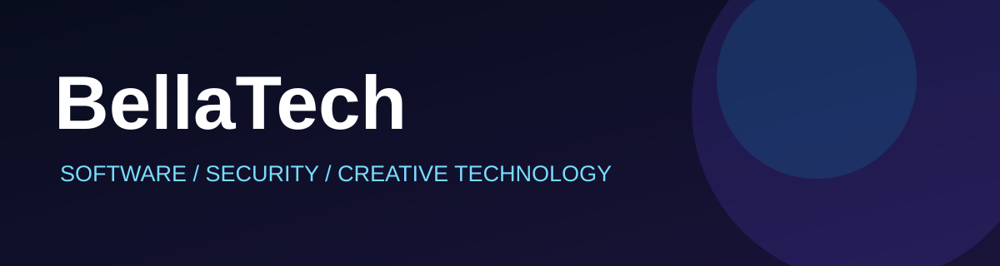

### Building the future, one line of code at a time.
**Full-Stack Development · Cybersecurity Research · AI · Game Development**

 

---

### 👋 About me | Chi sono

🇮🇹 Sviluppo software, piattaforme digitali e nuove esperienze interattive. Con BellaTech Web esploro tecnologie, sicurezza, intelligenza artificiale e progettazione di prodotti digitali.

🇬🇧 I build software, digital platforms and interactive experiences. Through BellaTech Web, I explore cybersecurity, AI, creative engineering and ambitious digital products.

### 🚀 Featured projects | Progetti

| Project | Description |
| :--- | :--- |
| **Mondelory** | Social platform focused on user experience, privacy and digital sharing. |
| **Somnethra** | Immersive survival-horror experience developed with Unreal Engine 5. |
| **BellaCrypt Core** | Experimental cryptographic research and adaptive security engineering. Not production-ready or independently validated. |

### ⚡ Technology stack

     

### 🧠 My philosophy

> Technology should be powerful, purposeful and built with care.

**Innovation · Security · Privacy · Creativity**

---

Designed with passion by BellaTech Web · Projects under active development
